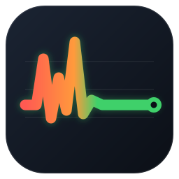

<p align="center"></p>

# StutterFree

**No more shader compilation stutter in your Proton games.** StutterFree precompiles the DirectX 12 pipelines and
DirectX 11 shaders into the driver cache **before** you play, using the same Proton / vkd3d-proton / DXVK as the game.

StutterFree is a modified Rust rewrite of **[Shaderless](https://github.com/cyberps96/Shaderless) 0.2.3-beta**, which is
itself the unofficial Linux port of **[SCSKiller](https://github.com/BlueHeisenberg/SCSKiller)**. It is not affiliated
with or endorsed by either project: the bugs in this version are ours.

## Download

Get `StutterFree-<version>-x86_64.AppImage` from the [releases](https://github.com/mmunozaguilar/stutterfree/releases):

```bash
chmod +x StutterFree-0.4.0-x86_64.AppImage
./StutterFree-0.4.0-x86_64.AppImage                     # the app
./StutterFree-0.4.0-x86_64.AppImage --install-desktop   # add it to your application menu
./StutterFree-0.4.0-x86_64.AppImage list                # the CLI: status, list, diagnose, settings, plan,
./StutterFree-0.4.0-x86_64.AppImage record "<game>" on  #   record, compile, compile-all, clear, clear-all
```

The AppImage needs no WebKit or any extra library: the interface is native (egui) and loads the system's Wayland, X11
and OpenGL at startup. It draws at the monitor's real refresh rate (144/180 Hz included). It ships a single executable
(the app and the command line), weighs about 10 MB and uses about 170 MB of RAM while open.
Each card shows what was compiled from the game's files ("From Game Files: 38,426 pipelines · Unreal 5.5 D3D12").
Scanning on startup can be turned off in Settings or with `stutterfree settings --scan-on-startup off`.

## How it works

1. **From the game's files (no recording needed)** for the engines below: StutterFree reads the shaders the game ships,
   plans the pipelines the game will create, and compiles them through Proton with a small native warmer.
2. **From a recording** for everything else: turn on ● Record, play for 5-10 minutes, close the game and press Compile.
   A recorder `d3d12.dll` next to the game logs every pipeline it creates. Games with anti-cheat can't be recorded.

### Engines read from the game files

- **Unity (DirectX 11):** serialized files and UnityFS bundles (LZ4/LZMA); every DX11 shader is compiled once with
  DXVK. Tested with V Rising (11,106 shaders), Wanderburg (10,176), Guildrun (3,313) and Rift of the NecroDancer (1,221).
- **Unreal Engine 4/5:** `.pak` files (v3-11) and unencrypted IoStore `.utoc/.ucas` containers (Oodle, zlib, LZ4),
  `ShaderArchive-*.ushaderbytecode` libraries, engine version and DX11/DX12 detection.
  - DX11: every shader, plus the tessellation pairs (HS+DS) of each material.
  - DX12: Unreal's root signatures are rebuilt (rules for 4.20 to 5.8, from each shader's resource counts, with the real
    DXBC checksum) and neutral-state pipelines are planned: every compute shader and, inside each material, every VS
    alone, VS→PS pair and VS→GS(→PS) chain whose signatures link; also global chains, material PSs behind the global
    VSs (Nanite) and, on UE5, the PSs shared by many materials. Shaders with a `[WaveSize]` the GPU can't run are left
    out (NVIDIA: 32; AMD: 32-64). Tested with MECCHA CHAMELEON (UE 5.5) on an RX 9070 XT: 38,426 pipelines, 0 failed.
  - Back 4 Blood uses a custom `.pak` format that can't be read (the original can't either).
- **FromSoftware:** the `.bhd` headers of the `.bdt` archives are decrypted with the game's public RSA keys and the
  shaders are taken from the `.shaderbnd.dcx` files (DCX + BND4).
  - Dark Souls III / Remastered (DirectX 11), tessellation pairs included. DS3's exe doesn't carry its keys in the clear:
    the ones published by UXM Selective Unpack are downloaded once and kept in `games/<id>/archive.keys`. Tested with
    Dark Souls III: 3,915 shaders and 174 tessellation pairs, 0 failed.
  - Elden Ring / Nightreign (DirectX 12): 64-bit name hashes, Oodle, keys in its own exe. Its shaders carry their root
    signature (RTS0 1.1), rewritten to the 1.0 version the game creates; pipelines come from each material (VS, VS→PS,
    VS→GS→PS) when all their stages carry the same signature. Tested: 161,387 pipelines, 0 failed. Elden Ring has
    anti-cheat, so it can't be recorded and shows "Partial".
- **Not yet:** DX12 tessellation and mesh shaders (no tested game uses them), the root signature rules of UE4 forks
  (Hogwarts Legacy, Jedi: Survivor, FF7 Rebirth), Elden Ring's ray tracing libraries, Unity's DX11 tessellation pairs,
  and the RE Engine, REDengine, Dagor and Northlight readers. Those games compile from a recording. The hook is
  `crates/stutterfree-core/src/engines.rs`; the C# reference code is in `reference/upstream/`.

### Also ported from Shaderless

- Game detection in Steam, Heroic (Epic, sideload, GOG) and Lutris (pga.db, Epic through Lutris, games added by exe),
  native and Flatpak.
- GPU detection (NVIDIA / Mesa RADV / ANV), cache statistics and clearing.
- Each game's Proton version (CompatToolMapping, `config_info`, `compatibilitytool.vdf`, Heroic, Lutris).
- **Record mode**: install/remove the recorder, import `shaderless.db` and `shaderless.keys`, anti-cheat detection (it
  refuses to install next to one).
- **Compiling**: incremental filtering, batches of 40,000, the warmer through `proton runinprefix`, NVIDIA cache packed in
  parts under 1.85 GB, vkd3d cache merging, installing where the game reads it, Proton's `user_settings.py`, stale
  cache detection (driver / Proton / game updated).
- A game exit monitor (imports the recording and, if enabled, compiles when the game closes).

The files it writes (`~/.local/share/stutterfree`, which copies Shaderless's data on first start: `settings.json`,
`games-cache-state.json`, `games/<id>/recording.db`, `warmed-keys.txt`…) use the same format as the C# version.

## Layout

| Path | What it is | C# original |
|---|---|---|
| `crates/stutterfree-core` | Logic: launchers, driver/GPU, Proton, recorder, NVIDIA/vkd3d caches, engine readers and planner, compiling | `SCSKiller.Linux.Core` + parts of `SCSKiller.Core` |
| `crates/stutterfree-cli` | The command line: a library (`run`) and the `stutterfree-cli` binary | `SCSKiller.Linux.Cli` |
| `crates/stutterfree-gui` | The `stutterfree` binary: native egui interface (same design as the original) at the monitor's refresh rate; given a command (`list`, `compile`…) or `--cli` it runs the command line | `SCSKiller.Linux.App` (Photino + HTML) |
| `native/` | Recorder `d3d12.dll` and warmer `shaderless_warm.exe` (C++, run inside Proton) | `Native/` + `upstream/proxy` |
| `packaging/appimage` | `AppRun` and `.desktop` | `install-desktop.sh` |

## Building

Dependencies (Arch / CachyOS):

```bash
sudo pacman -S --needed rust mingw-w64-gcc squashfs-tools
paru -S appimagetool-bin
```

```bash
cargo test                 # core tests
./build-native.sh          # d3d12.dll + shaderless_warm.exe with mingw
cargo run --release -p stutterfree         # the app
cargo run --release -p stutterfree -- list # the command line
./build-appimage.sh        # dist/StutterFree-<version>-x86_64.AppImage
```

Debugging variables: `STUTTERFREE_SCROLL_BENCH=1` (measures scrolling fps and quits),
`STUTTERFREE_OPEN_DIALOG=settings|diagnose`, `STUTTERFREE_MAXIMIZED=1`, `STUTTERFREE_DATA_DIR=<folder>`,
`STUTTERFREE_WARM_LOG=<file>` (keeps vkd3d-proton's errors from the warmer: why a pipeline failed).

## License

GPL-3.0-or-later with the additional permission in `LICENSE-EXCEPTION.txt`, like SCSKiller and Shaderless.
Copyright (C) 2026 The SCSKiller authors; Linux port (Shaderless) Copyright (C) 2026 cyberps96 and the Shaderless contributors;
Rust rewrite (StutterFree) Copyright (C) 2026 the StutterFree contributors.

StutterFree is free. If it helps you, you can support its development on [Ko-fi](https://ko-fi.com/maritokura) (the ☕
button in the app). It doesn't belong to any GPU maker, game engine or publisher; all trademarks belong to their owners.
